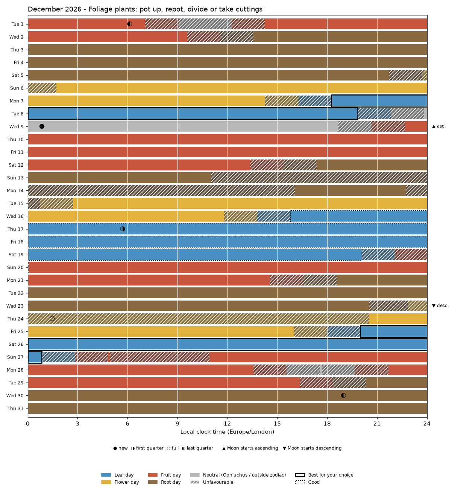
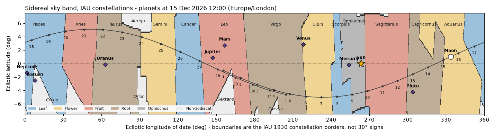

# Biodynamic Gardening Calendar

Best times to **sow, repot, take cuttings and harvest houseplants, and to make and apply the biodynamic preparations** using the biodynamic rhythms of
Maria Thun, after Rudolf Steiner's *Agriculture Course* (1924). The Moon is placed on a **sidereal sky chart
with the official IAU constellation boundaries**: real, unequal star constellations, not 30-degree signs.




## What it shows
* **Now**: an astrolabe of the sky at this moment for your place (like the Sidereal Oracle's wheel), with what the
  Moon means for your plants right now and the next Best time.
* **Best times**: windows for your plant group and task, with downloads as a calendar file (.ics) or spreadsheet (.csv).
* **Month view**: one row per day, coloured Leaf / Flower / Fruit / Root, with unfavourable times hatched.
* **Sky chart**: the Sun, Moon and planets among the IAU constellations, with the Moon's path for the month.
* **Moon events**: constellation changes, ascending/descending Moon, nodes, perigee, eclipses and phases.
* **Preparations**: the best times to make, bury, dig up and apply the biodynamic preparations BD 500-508 over the
  next 12 months (Steiner's seasons, later practice for the Moon and time of day, each rule with its source).
* **How it works**: the rules, the sources, and why some times differ from printed Thun calendars.

Dates: 1850-2149. Positions: NASA JPL DE440s via [Skyfield](https://rhodesmill.org/skyfield/).
Boundaries: IAU (Delporte 1930). Checked against JPL Horizons: in 30 of 30 tests the Moon's constellation
matched one minute either side of each computed change, and positions agreed within 0.04 arcseconds.

---

## Put it online (free, no programming)

You need two free accounts: **GitHub** (stores the files) and **Streamlit Community Cloud** (runs the app).

### Step 1 - Put the files on GitHub
1. Go to <https://github.com> and create an account (or sign in).
2. Click the **+** at the top right, then **New repository**.
3. Name it `biodynamic-gardening-calendar`, choose **Public**, and leave every "Add ..." box **unticked**.
   Click **Create repository**.
4. On the next page, click the link **uploading an existing file**.
5. Open this folder on your computer, select **everything inside it** (Ctrl+A), and drag it onto the GitHub page.
   This includes the folders `.streamlit`, `docs` and `ephem` and the file `.gitignore`.
6. Wait until all files are listed, then click **Commit changes** at the bottom.
7. Check that the list on GitHub shows **`.streamlit`**. If it is missing (some browsers skip folders whose
   names start with a dot), click **Add file > Create new file**, type `.streamlit/config.toml` as the name,
   paste the lines below, and click **Commit changes**:
   ```
   [server]
   headless = true

   [browser]
   gatherUsageStats = false

   [theme]
   base = "light"
   primaryColor = "#3f7d4e"
   backgroundColor = "#f7f5ef"
   secondaryBackgroundColor = "#e8efe4"
   textColor = "#22301f"
   ```
   (Without this file the app still works, but in Streamlit's default colours.)

### Step 2 - Start the app on Streamlit Community Cloud
1. Go to <https://share.streamlit.io> and click **Continue with GitHub**. Allow Streamlit to see your repositories.
2. Click **Create app** (top right), then **Deploy a public app from GitHub** ("Yup, I have an app").
3. Fill in:
   * **Repository**: `your-github-name/biodynamic-gardening-calendar` (or your existing repository, if you already made one)
   * **Branch**: `main`
   * **Main file path**: `app.py`
   * **App URL**: choose a name you like, for example `houseplant-moon`
4. Open **Advanced settings**, choose Python **3.12**, and click **Save**.
5. Click **Deploy**. The first start takes a few minutes, because the server installs the packages and downloads
   the 32 MB NASA ephemeris. After that, the link (`https://your-name.streamlit.app`) works for anyone.

**To change something later:** edit a file on GitHub (open it, click the pencil icon, then **Commit changes**).
The app updates itself within a minute. The rule tables `constellation_organs.csv`, `plant_groups.csv` and
`activities.csv` can be edited this way.

**If you already put an earlier version online:** open your repository on GitHub, click **Add file > Upload files**,
drag in everything from this folder again (files with the same name are replaced; the new folders `assets` and
`tools` and the new files `device.py` and `theme.py` are added), and click **Commit changes**. Then open the app,
click **Manage app** (bottom right, only you see it) > the three dots > **Reboot app**.

**If the app goes to sleep:** free apps sleep after a few days without visitors. The next visitor sees a button
to wake it up, which takes about a minute.

---

## Use it on an iPhone, iPad or Android phone or tablet
Once the app is online (Steps 1 and 2 above), open its `https://....streamlit.app` link on the phone or tablet.
* **Phone layout**: on phones and Android tablets it switches on by itself. The settings move into a fold-out panel
  at the top ("Your settings"), best times and the month are shown as lists in large text, and the charts are drawn
  at phone size. On an iPad, which tells websites it is a Mac, open the sidebar (the **>** at the top left) and
  switch **Phone layout** on if you prefer it.
* **Put it on the home screen like an app**:
  * **iPhone / iPad (Safari)**: tap the **Share** button (square with an arrow), then **Add to Home Screen**, then **Add**.
  * **Android (Chrome)**: tap the **three dots** at the top right, then **Add to home screen** (or **Install app**).
  The home-screen icon opens the app directly. It still needs the internet, and after a few quiet days the
  first visit may show Streamlit's "wake up" button.
* **Calendar file**: on the phone, the "Add to my calendar (.ics file)" button offers to add the windows to the
  phone's own calendar.

---

## Run it on your own Windows PC instead
Download this repository (green **Code** button > **Download ZIP**), extract it, and double-click **`Start app.bat`**.
Double-click **`Create desktop icon.bat`** once to get a desktop and Start-menu icon, "Biodynamic Gardening Calendar", that starts the app in its own window (it replaces an older "Biodynamic Houseplant Calendar" icon).
You need [Python](https://www.python.org/downloads/); tick "Add python.exe to PATH" when you install it.
The first start sets things up, which needs the internet and takes a few minutes. After that, the app opens in your browser.

For programmers: `pip install -r requirements.txt` then `streamlit run app.py`.

## Files
| File | What it is |
|---|---|
| `app.py` | the web interface (Streamlit) |
| `biodyn_engine.py` | astronomy and biodynamic rules |
| `charts.py` | month view and sky chart (computer and phone versions) |
| `device.py` | phone layout switch (finds phones by their browser) |
| `theme.py` | page styles for touch screens and phones |
| `assets/` | the app icon |
| `Start app.bat`, `Create desktop icon.bat`, `tools/` | for running on a Windows PC (not used online) |
| `constellation_organs.csv` | constellation -> element -> day type (editable) |
| `plant_groups.csv` | plant groups with examples (editable) |
| `activities.csv` | which Moon direction each task prefers (editable) |
| `preparations.csv` | rules for the preparations BD 500-508 (editable) |
| `preparations.py` | works out the preparation times |
| `astrolabe.py` | draws the astrolabe and the "Right now" summary |
| `HOW_IT_WORKS.md` | explanation shown in the app |
| `ephem/` | the ephemeris is downloaded here on first start (not stored on GitHub) |

## Credits and note
* Ephemeris: NASA JPL DE440s (Park et al. 2021). Software: Skyfield, Streamlit, matplotlib, pandas, NumPy.
* IAU constellation boundaries: Delporte (1930), as tabulated by Roman (1987).
* Rules: Maria Thun's biodynamic sowing calendar. Avoidance windows follow Thun and Stella Natura and can be adjusted in the app.
* Biodynamic timing is a traditional practice. Controlled scientific trials have not shown that the Moon's constellation changes plant growth.
